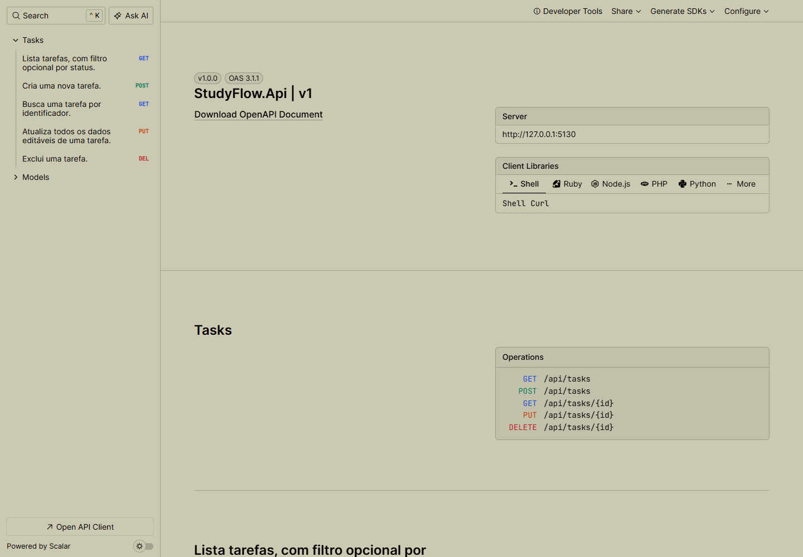
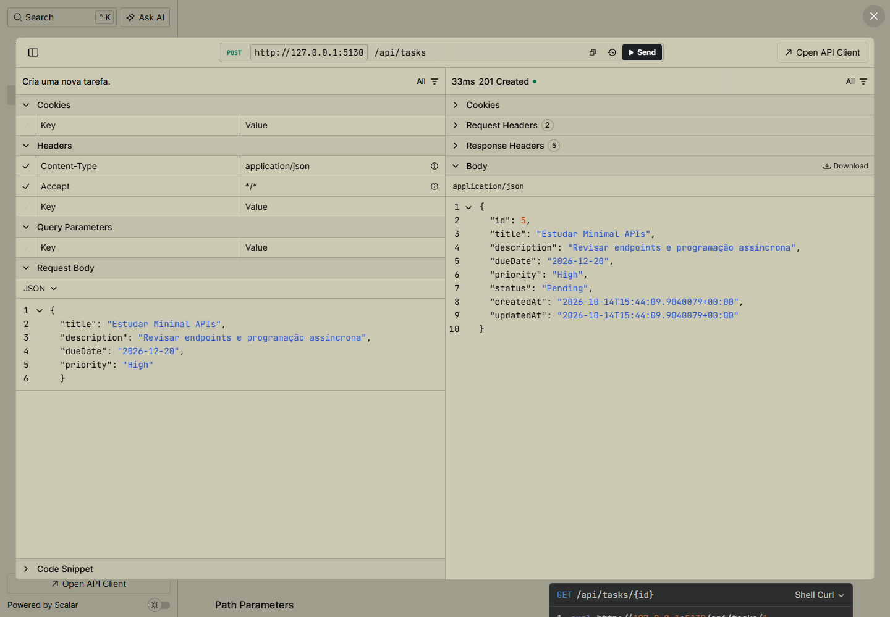
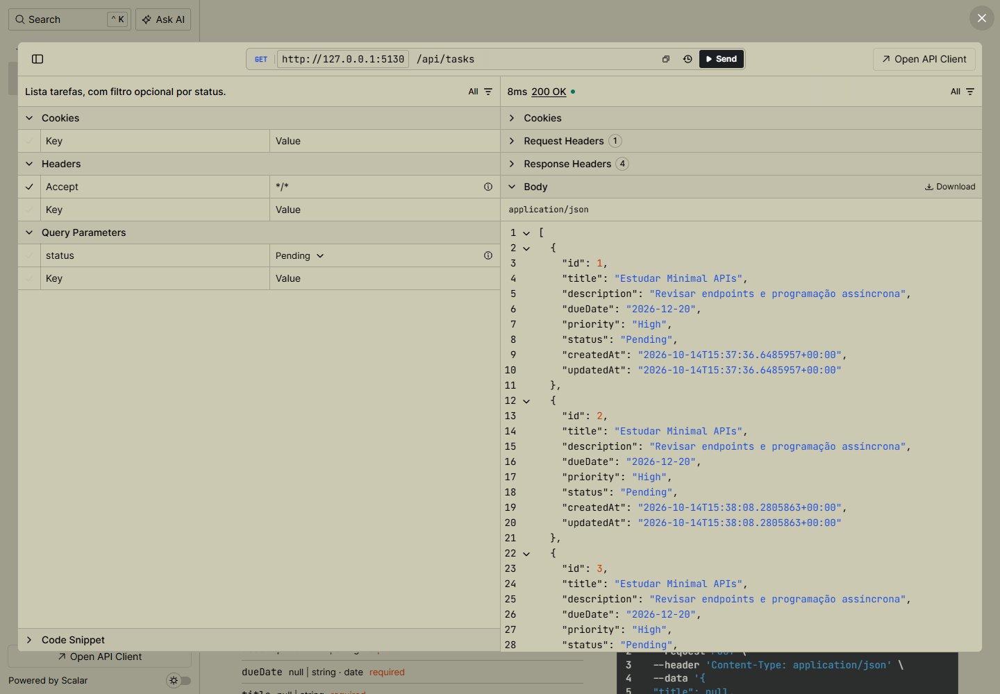
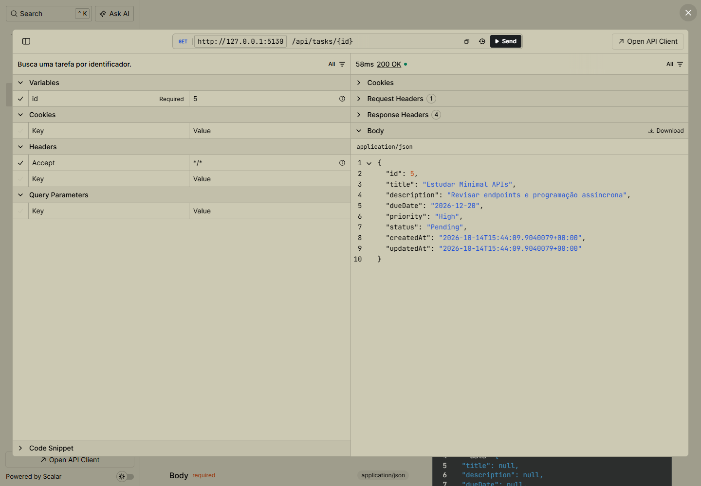
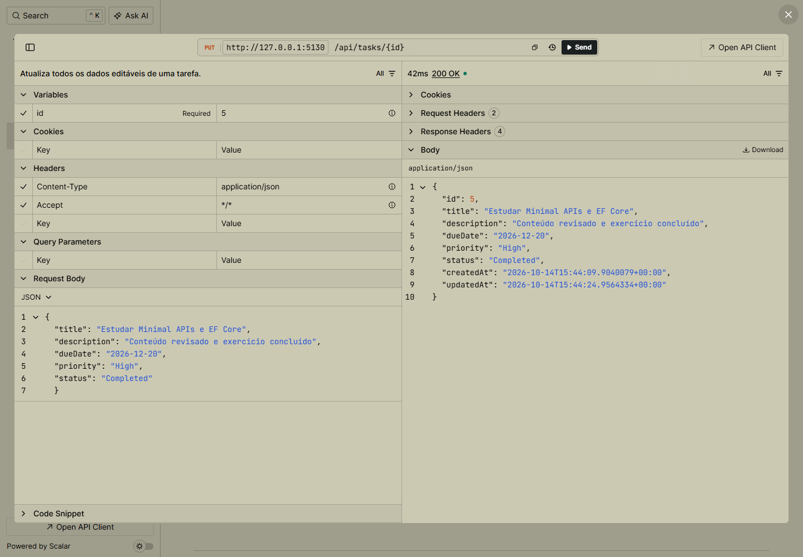
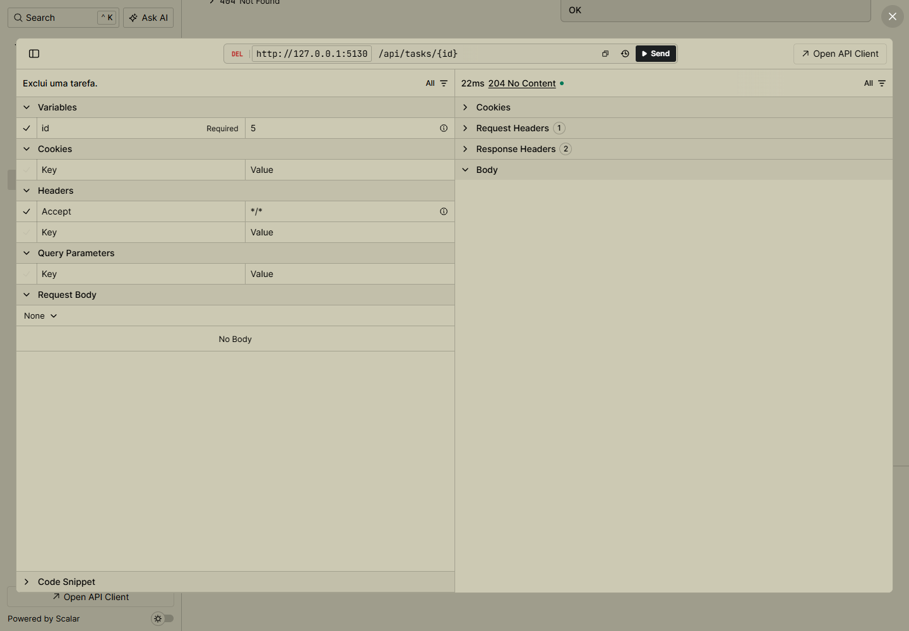

# StudyFlow API

API RESTful para organização de tarefas de estudo, desenvolvida com **C#**, **.NET 10**, **ASP.NET Core Minimal APIs** e **Entity Framework Core**.

O projeto não utiliza Controllers nem o atributo `[ApiController]`. Todas as rotas são registradas com `MapGet`, `MapPost`, `MapPut` e `MapDelete`, e todas as operações que acessam ou persistem dados utilizam `async`/`await`.

## Integrantes

- **Enzo Almeida** — RM556900 — GitHub: [@enzoalmeiida](https://github.com/enzoalmeiida)
- **Gabriel de Mello** — RM554421
- **Guilherme Moreira** — RM557290

## Contexto do projeto

O StudyFlow ajuda estudantes a registrar e acompanhar tarefas acadêmicas, como trabalhos, leituras, provas e exercícios. Cada tarefa possui título, descrição, prazo, prioridade e status. A solução é destinada a estudantes que precisam centralizar suas atividades e visualizar o que está pendente, em andamento ou concluído.

O problema resolvido é a dispersão de compromissos acadêmicos em anotações e aplicativos diferentes. A API fornece uma base simples para futuros clientes web, mobile ou desktop consumirem os dados.

## Tecnologias

- .NET 10 e C#;
- ASP.NET Core Minimal APIs;
- Entity Framework Core 10;
- SQLite;
- OpenAPI e Scalar;
- xUnit para testes automatizados.

## Banco de dados

O banco utilizado é o **SQLite**. O arquivo `studyflow.db` é criado localmente ao aplicar as migrations ou iniciar a aplicação. O arquivo do banco não é versionado no GitHub.

## Como executar localmente

### Pré-requisitos

- [.NET SDK 10](https://dotnet.microsoft.com/download/dotnet/10.0);
- Git;
- VS Code, Visual Studio ou apenas um terminal.

### Passo a passo

```bash
git clone https://github.com/enzoalmeiida/studyflow-api.git
cd StudyFlow
dotnet tool restore
dotnet restore
dotnet ef database update --project src/StudyFlow.Api
dotnet run --project src/StudyFlow.Api
```

A aplicação também executa `MigrateAsync` ao iniciar, portanto migrations pendentes são aplicadas automaticamente. O comando `dotnet ef database update` foi mantido acima para demonstrar explicitamente como aplicar as migrations.

Após iniciar, acesse:

- Scalar (documentação e testes): <http://localhost:5130/scalar/v1>
- Documento OpenAPI: <http://localhost:5130/openapi/v1.json>

O perfil definido em `launchSettings.json` usa a porta HTTP `5130`. Caso o terminal informe outra porta, utilize a URL exibida nele.

## Endpoints disponíveis

| Método | Rota | Descrição | Respostas principais |
|---|---|---|---|
| `GET` | `/api/tasks` | Lista todas as tarefas | `200 OK` |
| `GET` | `/api/tasks?status=Pending` | Filtra tarefas por status | `200 OK` |
| `GET` | `/api/tasks/{id}` | Busca uma tarefa por ID | `200 OK`, `404 Not Found` |
| `POST` | `/api/tasks` | Cria uma tarefa | `201 Created`, `400 Bad Request` |
| `PUT` | `/api/tasks/{id}` | Atualiza uma tarefa inteira | `200 OK`, `400 Bad Request`, `404 Not Found` |
| `DELETE` | `/api/tasks/{id}` | Exclui uma tarefa | `204 No Content`, `404 Not Found` |

### Valores aceitos

- `priority`: `Low`, `Medium` ou `High`;
- `status`: `Pending`, `InProgress` ou `Completed`.

### Exemplo para criar uma tarefa

```json
{
  "title": "Estudar Minimal APIs",
  "description": "Revisar endpoints e programação assíncrona",
  "dueDate": "2026-12-20",
  "priority": "High"
}
```

### Exemplo para atualizar uma tarefa

```json
{
  "title": "Estudar Minimal APIs e EF Core",
  "description": "Conteúdo revisado e exercício concluído",
  "dueDate": "2026-12-20",
  "priority": "High",
  "status": "Completed"
}
```

Também há uma coleção pronta em [`src/StudyFlow.Api/StudyFlow.Api.http`](src/StudyFlow.Api/StudyFlow.Api.http), executável pelo VS Code com a extensão REST Client ou pelo Visual Studio.

## Programação assíncrona

As consultas e alterações do banco usam os métodos assíncronos do EF Core, incluindo:

- `ToListAsync` e `FirstOrDefaultAsync` para consultas;
- `AddAsync` para inclusão;
- `SaveChangesAsync` para persistência;
- `ExecuteDeleteAsync` para exclusão;
- `MigrateAsync` para migrations na inicialização.

Os endpoints recebem `CancellationToken`, permitindo cancelar operações quando a requisição HTTP é interrompida.

## Validações e tratamento de erros

- título obrigatório com até 120 caracteres;
- descrição com até 500 caracteres;
- prazo não pode estar no passado;
- respostas de validação seguem o formato `ProblemDetails`;
- IDs inexistentes retornam `404 Not Found`;
- erros inesperados são registrados e retornam `500 Internal Server Error` sem expor detalhes internos.

## Estrutura do projeto

```text
StudyFlow/
├── docs/evidencias/              # Prints dos endpoints funcionando
├── src/StudyFlow.Api/
│   ├── Contracts/                # DTOs de entrada e saída
│   ├── Data/                     # DbContext do EF Core
│   ├── Endpoints/                # Rotas da Minimal API
│   ├── Infrastructure/           # Tratamento global de erros
│   ├── Migrations/               # Versionamento do banco
│   ├── Models/                   # Entidades e enums
│   └── Validation/               # Regras de validação
└── tests/StudyFlow.Api.Tests/    # Testes automatizados
```

## Testes automatizados

Execute:

```bash
dotnet test
```

Os testes verificam as principais regras de validação da API.

## Evidências de funcionamento

### Documentação OpenAPI no Scalar



### POST — criar tarefa



### GET — listar tarefas



### GET — buscar tarefa por ID



### PUT — atualizar tarefa



### DELETE — excluir tarefa


